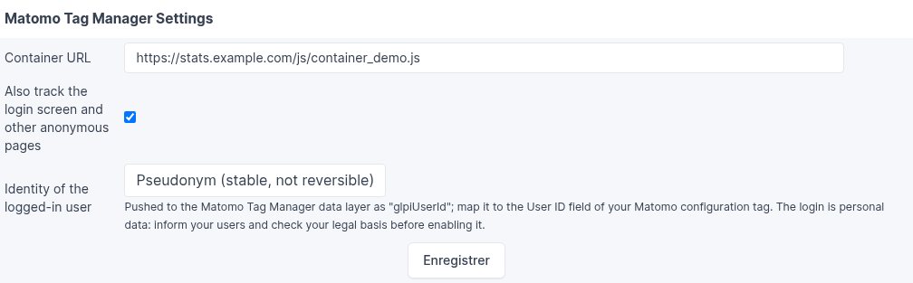
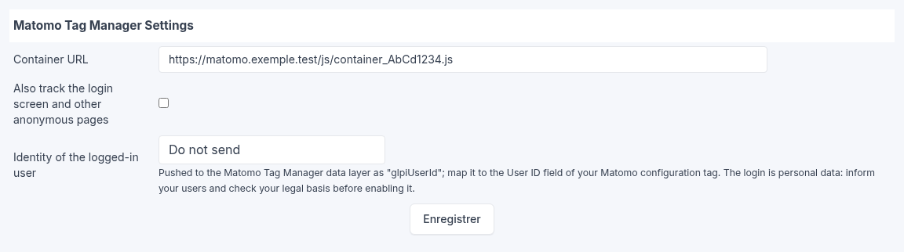
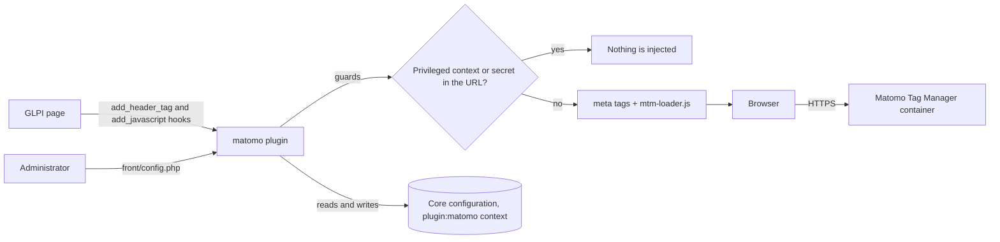

# Matomo Tag Manager — inject a Matomo container into GLPI pages

[Français](README.md) · **English**

[](https://www.gnu.org/licenses/gpl-2.0.html)
[](https://glpi-project.org)
[](https://www.php.net/)



> A GLPI plugin that loads a [Matomo Tag Manager](https://matomo.org/guide/tag-manager/) container
> into the pages seen by logged-in users, with no change to GLPI code: paste the container URL in the
> settings. If you opt in, it can also tell Matomo **who** the user is, through a non-reversible
> pseudonym or the GLPI login.

## Features

- **Audience measurement without touching GLPI**: the container loads on the pages of logged-in
  users (standard and simplified interfaces); the login screen and other anonymous pages load it
  only on request, **off by default**.
- **Optional identity** pushed to the MTM data layer as `glpiUserId`: nothing (default), a stable
  non-reversible pseudonym, or the GLPI login in clear.
- **Guards for third-party code**: the container never runs for an administrator, on an
  administration page, or on an address carrying a secret (password-reset token…).
- **Set up from GLPI**: one page, no file or template to edit.
- **Light**: native GLPI hooks and one small static asynchronous JavaScript loader; no table of its
  own, the settings live in the core configuration.

## Requirements

| Component | Version |
|---|---|
| GLPI | 11.x (plugin 1.0.x) · 12.x (plugin 1.1.x, `glpi-12` branch) · 10.x (plugin 1.0.0, no login screen or identity) |
| PHP | 8.2 or later |
| Matomo | A Matomo Tag Manager container URL reachable from your users' browsers |

## Installation

1. Download the latest archive from the
   [Releases](https://github.com/FathiBenNasr/glpi-matomo/releases) page, or install the plugin from
   git with the **Git Plugin Installer** plugin.
2. Extract it into GLPI's `plugins/` directory so the path is `plugins/matomo/` (the folder is
   called `matomo`, not `glpi-matomo`).
3. Install and enable as the web server user (never as root), or through
   **Setup → Plugins → Matomo Tag Manager → Install → Enable**:

   ```bash
   sudo -u apache php bin/console plugin:install matomo
   sudo -u apache php bin/console plugin:activate matomo
   sudo -u apache php bin/console cache:clear
   ```

## Configuration

Page **Setup → Plugins → Matomo Tag Manager** (configuration icon). It requires the GLPI core
`config` right at update level.

| Setting | Default | Effect |
|---|---|---|
| **Container URL** | empty (measurement off) | HTTPS URL of the MTM container: `https://host/…/container_<id>.js`, no credentials, query or fragment. Any other shape is refused when saving and again when emitted. |
| **Also track the login screen and other anonymous pages** | unticked | Also loads the container on the login screen and anonymous pages. No identity is ever sent there. |
| **Identity of the logged-in user** | **Do not send** | **Pseudonym**: HMAC-SHA256 of the GLPI user id, keyed with the plugin's own salt (stable, not reversible); **GLPI login**: the login in clear. |

The labels on the page are in English: the plugin ships no translation file. Each setting is
detailed in [docs/ADMINISTRATION.en.md](docs/ADMINISTRATION.en.md#configuration).

## Usage

1. Open **Setup → Plugins → Matomo Tag Manager**.
2. Paste the container URL, for example `https://stats.example.com/js/container_AbCd1234.js`.
3. Choose whether the login screen is measured and which identity to send (none by default).
4. Click **Save**: the container is injected on the next page load.

To use the identity in Matomo, create a *Data Layer* variable named `glpiUserId` in Tag Manager and
set it as the **User ID** of your Matomo configuration variable. Step-by-step tasks:
[docs/GUIDE.en.md](docs/GUIDE.en.md).

## Screenshots

Generated by the browser bench, on fictitious data: see
[docs/captures/](docs/captures/README.md).



## Architecture



The plugin hands its settings to the page as `<meta>` tags (escaped by GLPI's template) and loads one
static script, `public/js/mtm-loader.js`, which reads the tags back, pushes `glpiUserId` when there
is one, then starts MTM. No table of its own, no file written at runtime. Details (French):
[docs/ARCHITECTURE.md](docs/ARCHITECTURE.md).

## Security

An MTM container is **third-party code that its publishers can change at any time**; it runs with
the privileges of the GLPI origin. The plugin therefore never loads it for a session that can change
configuration, profiles or accounts, nor on an administration page, nor on an address (or referrer)
carrying a secret, and it fails closed. Sending an identity to Matomo links every visit to a person:
the pseudonym **is still personal data** (GDPR, Tunisian law 2004-63); inform your users before
enabling it. Full analysis (French): [docs/SECURITE.md](docs/SECURITE.md). To report a flaw:
[SECURITY.md](SECURITY.md).

## Tests

```bash
php tests/run.php            # or: phpunit --no-configuration tests/   (46 tests)
node --test tests/*.test.js  # the real loader, in a vm sandbox        (9 tests)
```

## Troubleshooting

| Symptom | Likely cause | Remedy |
|---|---|---|
| Nothing is measured | Empty container URL, inactive plugin, or excluded page (administration, address with a token, administrator or impersonated session) | Check the URL and activation; test with an account without administration rights |
| "Container URL must be an https:// …" when saving | Refused URL shape (HTTP, credentials, query, path other than `/container_<id>.js`) | Paste the exact URL given by Matomo Tag Manager |
| Pseudonym mode but no identity at all | Salt missing after an upgrade (fails closed) | `sudo -u apache php bin/console plugin:install --force matomo` |
| All plugin pages return 404 after an update | GLPI disabled the plugin (code and database out of step) | Reinstall as above, then re-enable |
| `glpiUserId` does not show up in Matomo | *Data Layer* variable not created or not linked to the User ID field | See [Usage](#usage) |

More cases in [docs/ADMINISTRATION.en.md](docs/ADMINISTRATION.en.md#troubleshooting).

## Changelog

See [CHANGELOG.md](CHANGELOG.md).

## License

Distributed under the [GNU GPL v2.0 or later](LICENSE) license (SPDX: `GPL-2.0-or-later`).

---

<div align="center">

## Developed by

[](https://www.convergent.tn)

**[Convergent Cloud Computing](https://www.convergent.tn)**  
Cloud infrastructure, open-source integration, and cybersecurity solutions for Tunisian and international businesses.

📧 contact@convergent.tn | 🌐 [www.convergent.tn](https://www.convergent.tn)

</div>
