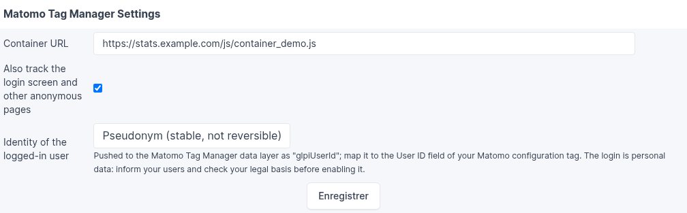
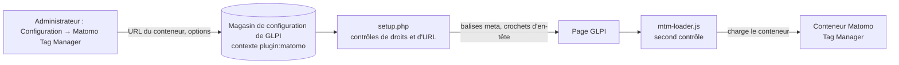

# Matomo Tag Manager — injecter un conteneur Matomo dans les pages de GLPI

**Français** · [English](README.en.md)



> Un greffon de [GLPI](https://glpi-project.org/) qui charge un conteneur [Matomo Tag Manager](https://matomo.org/guide/tag-manager/)
> dans les pages des utilisateurs connectés, sans modifier le code : on colle l'URL du conteneur dans les réglages. Il
> peut aussi dire à Matomo **qui** est l'utilisateur, par un pseudonyme ou par son identifiant GLPI.

Le conteneur n'est **jamais** chargé pour un administrateur ni sur une page d'administration : il s'exécute avec les
droits de l'origine GLPI, et quiconque peut le publier ne doit pas agir en administrateur.

## Fonctionnalités

- Charge le conteneur Matomo Tag Manager sur les pages des utilisateurs connectés (interface standard et simplifiée),
  et, en option, sur l'écran de connexion (désactivé par défaut).
- **Identité facultative** poussée dans la couche de données MTM sous le nom `glpiUserId` : un pseudonyme non
  réversible, ou l'identifiant GLPI (voir *Vie privée*).
- Se règle entièrement depuis le panneau d'administration de GLPI : aucun fichier ni gabarit à éditer.
- Crochets natifs de GLPI et un petit chargeur JavaScript statique, asynchrone.
- Aucune table de base de données : les réglages vivent dans le magasin de configuration de GLPI.

## Prérequis

| Prérequis | Version |
|-----------|---------|
| GLPI | 11.x pour ce dépôt (`setup.php` : de 11.0.0 à 11.99.99). Les lignes 12.x (greffon 1.1.x) et 10.x (greffon 1.0.0) existent dans l'historique et sur d'autres branches |
| PHP | 8.2 ou plus, selon l'ancien README du dépôt (à vérifier : `setup.php` ne le déclare pas) |
| Matomo | l'URL d'un conteneur Matomo Tag Manager joignable par les navigateurs |

## Installation

1. Télécharger l'archive de la dernière version sur la page des [versions](https://github.com/FathiBenNasr/glpi-matomo/releases),
   ou l'installer depuis Git avec le greffon **Git Plugin Installer**.
2. L'extraire dans le dossier `plugins/` de GLPI, de sorte que le chemin soit `plugins/matomo/`.
3. L'installer et l'activer sous l'identité du serveur web, ou par l'interface
   (**Configuration → Plugins → Matomo Tag Manager → Installer → Activer**) :
   ```bash
   sudo -u apache php bin/console plugin:install matomo
   sudo -u apache php bin/console plugin:activate matomo
   sudo -u apache php bin/console cache:clear
   ```

Jamais `bin/console` en `root` : il crée des caches que le serveur web ne peut plus écrire. Procédure détaillée :
[docs/ADMINISTRATION.md](docs/ADMINISTRATION.md).

## Configuration

| Réglage | Défaut | Effet |
|---------|--------|-------|
| URL du conteneur | vide (suivi désactivé) | URL HTTPS complète du script du conteneur (`https://…/js/container_XXXXXXXX.js`). Seule la forme d'un conteneur MTM est acceptée : `https://`, un hôte, ni identifiants, ni requête, ni fragment, un chemin qui finit par `/container_<id>.js`. |
| Suivre aussi l'écran de connexion | désactivé | Charge le conteneur sur les pages anonymes (connexion, mot de passe oublié). Aucune identité n'y est jamais envoyée, et une URL qui porte un jeton n'est jamais suivie. |
| Identité de l'utilisateur connecté | ne pas envoyer | **Pseudonyme** : HMAC-SHA256 de l'identifiant GLPI, avec un sel aléatoire propre au greffon et chiffré par la clé de GLPI. **Identifiant GLPI** : en clair. |

Les valeurs sont rangées dans le contexte `plugin:matomo` de la configuration de GLPI. Pour utiliser l'identité dans
Matomo : dans Tag Manager, créer une variable de couche de données `glpiUserId`, puis la donner comme **User ID** à
la variable *Matomo Configuration*.

## Utilisation

1. Ouvrir **Configuration → Plugins**, puis le lien de configuration de **Matomo Tag Manager**.
2. Coller l'**URL du conteneur** Matomo Tag Manager (ex. `https://stats.example.com/js/container_XXXXXXXX.js`).
3. Choisir de suivre ou non l'écran de connexion, et l'**identité** à envoyer (par défaut : aucune).
4. Cliquer sur **Enregistrer** : le conteneur est chargé dès la page suivante.

Pas à pas, avec la capture : [docs/GUIDE.md](docs/GUIDE.md).

## Captures


La page de réglages, engendrée par le banc navigateur contre un GLPI jetable, avec une URL de conteneur fictive :
[docs/captures/](docs/captures/README.md).

## Architecture



Le greffon passe ses réglages en balises `<meta>` par les crochets `add_header_tag` et
`add_header_tag_anonymous_page` (échappées par le gabarit de GLPI), et charge un script statique,
`public/js/mtm-loader.js`. Le détail est dans [docs/ARCHITECTURE.md](docs/ARCHITECTURE.md).

## Sécurité

Un conteneur Matomo Tag Manager est du **code tiers modifiable à tout moment** par ceux qui le publient ; il s'exécute
avec les droits de l'origine GLPI. Le greffon :

- ne le charge jamais pour une session qui détient `config`, `profile` ou `user` en mise à jour (dans n'importe lequel
  de ses profils), ni sur les pages d'administration, ni pendant une usurpation d'identité ; un contrôle de droit qui
  échoue vaut « privilégié » ;
- ne le charge jamais sur une URL portant un secret (`password_forget_token`, `*token*`, `*passw*`, `*secret*`,
  `code`, `state`), ni sur une page dont le référent en porte un ;
- refait ces contrôles dans le chargeur, en seconde couche ;
- n'accepte qu'une URL de conteneur HTTPS de la forme attendue, à l'enregistrement puis à l'émission.

Reste à la charge de l'exploitant : limiter le droit de *publier* du conteneur, et poser une politique CSP sur l'hôte
virtuel de GLPI. Analyse complète : [docs/SECURITE.md](docs/SECURITE.md). Signaler une faille : [SECURITY.md](SECURITY.md).

### Vie privée

Envoyer une identité à Matomo relie chaque visite à une personne : au sens du RGPD et de la loi tunisienne 2004-63,
le **pseudonyme reste une donnée personnelle**, l'identifiant GLPI davantage. Avant de l'activer : disposer d'une base
légale, informer les utilisateurs, auto-héberger Matomo si possible, préférer le pseudonyme. L'identité n'est jamais
envoyée sur une page anonyme, et sans le sel du greffon aucun pseudonyme n'est produit (jamais de repli sur
l'identifiant). Côté Matomo : activer l'anonymisation des adresses IP et exclure les paramètres `password_forget_token`,
`token` et `_glpi_csrf_token`.

## Tests

```bash
php tests/run.php            # ou : phpunit --no-configuration tests/  (46 tests)
node --test tests/*.test.js  # le vrai chargeur, dans un bac à sable vm (9 tests)
```

## Dépannage

| Symptôme | Cause | Remède |
|----------|-------|--------|
| Rien ne se charge pour moi, administrateur | Voulu : pas de conteneur tiers pour une session qui détient `config`, `profile` ou `user` en mise à jour, ni sur les pages d'administration | Tester avec un compte sans droit d'administration |
| « Container URL must be an https:// Matomo Tag Manager container » à l'enregistrement | L'URL n'a pas la forme `https://hôte/…/container_<id>.js` (ni identifiants, ni requête, ni fragment) | Recopier l'URL de la page *Code d'installation* de Matomo et retirer ce qui suit `.js` |
| Le mode pseudonyme n'envoie aucune identité | Le sel du greffon n'existe pas (montée de version sans réinstallation) : le greffon échoue fermé | `sudo -u apache php bin/console plugin:install --force matomo` |
| Toutes les pages du greffon répondent 404 après une montée de version | GLPI a désactivé le greffon : la version du code ne correspond plus à celle enregistrée | Réinstaller comme ci-dessus, puis `plugin:activate matomo` |
| Rien sur l'écran de connexion | Le suivi des pages anonymes est désactivé par défaut, ou l'URL porte un jeton | Cocher **Suivre aussi l'écran de connexion…** |

Autres cas : [docs/ADMINISTRATION.md](docs/ADMINISTRATION.md#dépannage).

## Documentation

- [Guide d'utilisation](docs/GUIDE.md) · [Administration](docs/ADMINISTRATION.md)
- [Architecture](docs/ARCHITECTURE.md) · [Sécurité](docs/SECURITE.md) · [Signaler une faille](SECURITY.md)

## Historique

Voir [CHANGELOG.md](CHANGELOG.md) (en anglais).

## Licence

SPDX : `GPL-2.0-or-later` — voir [LICENSE](LICENSE).

## Auteur

[Convergent Cloud Computing](https://www.convergent.tn) — contact@convergent.tn. Anomalies et demandes :
[suivi des tickets](https://github.com/FathiBenNasr/glpi-matomo/issues).
