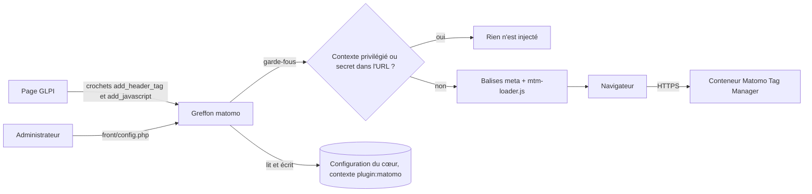

# Matomo Tag Manager — injecter un conteneur Matomo dans les pages de GLPI

**Français** · [English](README.en.md)

[](https://www.gnu.org/licenses/gpl-2.0.html)
[](https://glpi-project.org)
[](https://www.php.net/)


> Greffon GLPI qui charge un conteneur [Matomo Tag Manager](https://matomo.org/guide/tag-manager/)
> dans les pages vues par les utilisateurs connectés, sans toucher au code de GLPI : il suffit de
> coller l'URL du conteneur dans les réglages. Il peut, si l'on y consent, dire à Matomo **qui**
> est l'utilisateur, par un pseudonyme non réversible ou par son identifiant GLPI.

## Fonctionnalités

- **Mesure d'audience sans modifier GLPI** : le conteneur se charge sur les pages des utilisateurs
  connectés (interface standard et interface simplifiée) ; l'écran de connexion et les autres pages
  anonymes ne le chargent que sur option, **désactivée par défaut**.
- **Identité facultative** poussée dans la couche de données de MTM sous le nom `glpiUserId` :
  rien (par défaut), un pseudonyme stable et non réversible, ou l'identifiant GLPI en clair.
- **Garde-fous pour du code tiers** : le conteneur ne s'exécute jamais pour un administrateur, ni sur
  une page d'administration, ni sur une adresse qui porte un secret (jeton de réinitialisation…).
- **Réglage depuis GLPI** : une seule page, aucun fichier ni gabarit à éditer.
- **Léger** : crochets natifs de GLPI et un petit chargeur JavaScript statique, asynchrone ; aucune
  table propre, les réglages vivent dans la configuration du cœur.

## Prérequis

| Composant | Version |
|---|---|
| GLPI | 11.x (greffon 1.0.x) · 12.x (greffon 1.1.x, branche `glpi-12`) · 10.x (greffon 1.0.0, sans écran de connexion ni identité) |
| PHP | 8.2 ou plus |
| Matomo | l'URL d'un conteneur Matomo Tag Manager joignable depuis les navigateurs de vos utilisateurs |

## Installation

1. Téléchargez la dernière archive depuis la page des
   [versions](https://github.com/FathiBenNasr/glpi-matomo/releases), ou installez le greffon depuis
   git avec le greffon **Git Plugin Installer**.
2. Décompressez-la dans le dossier `plugins/` de GLPI : le chemin doit être `plugins/matomo/`
   (le dossier s'appelle `matomo`, pas `glpi-matomo`).
3. Installez et activez, en tant qu'utilisateur du serveur web (jamais en root), ou par
   **Configuration → Plugins → Matomo Tag Manager → Installer → Activer** :

   ```bash
   sudo -u apache php bin/console plugin:install matomo
   sudo -u apache php bin/console plugin:activate matomo
   sudo -u apache php bin/console cache:clear
   ```

## Configuration

Page **Configuration → Plugins → Matomo Tag Manager** (icône de configuration). Elle exige le droit
`config` en mise à jour du cœur de GLPI.

| Réglage | Défaut | Effet |
|---|---|---|
| **Container URL** | vide (mesure désactivée) | URL HTTPS du conteneur MTM : `https://hôte/…/container_<id>.js`, sans identifiant, requête ni fragment. Toute autre forme est refusée à l'enregistrement et à l'émission. |
| **Also track the login screen and other anonymous pages** | décoché | Charge aussi le conteneur sur l'écran de connexion et les pages anonymes. Aucune identité n'y est jamais envoyée. |
| **Identity of the logged-in user** | **Do not send** | **Pseudonym** : HMAC-SHA256 de l'identifiant GLPI, clé de sel propre au greffon (stable, non réversible) ; **GLPI login** : identifiant en clair. |

Les libellés de la page sont en anglais : le greffon n'a pas de fichier de traduction. Détail de
chaque réglage dans [docs/ADMINISTRATION.md](docs/ADMINISTRATION.md#configuration).

## Utilisation

1. Ouvrez **Configuration → Plugins → Matomo Tag Manager**.
2. Collez l'URL du conteneur, par exemple `https://stats.example.com/js/container_AbCd1234.js`.
3. Choisissez si l'écran de connexion est mesuré et quelle identité envoyer (aucune par défaut).
4. Cliquez sur **Save** (**Enregistrer** dans l'interface française) : le conteneur est injecté au chargement de page suivant.

Pour exploiter l'identité dans Matomo, créez dans Tag Manager une variable de type *Data Layer* nommée
`glpiUserId` et affectez-la au champ **User ID** de votre variable de configuration Matomo. Tâches
pas à pas : [docs/GUIDE.md](docs/GUIDE.md).

## Captures

Engendrées par le banc navigateur, sur des données fictives : voir
[docs/captures/](docs/captures/README.md).


## Architecture



Le greffon transmet ses réglages à la page sous forme de balises `<meta>` (échappées par le gabarit
de GLPI) et charge un seul script statique, `public/js/mtm-loader.js`, qui relit ces balises, pousse
`glpiUserId` s'il y en a une, puis démarre MTM. Aucune table propre, aucun fichier écrit à
l'exécution. Détail : [docs/ARCHITECTURE.md](docs/ARCHITECTURE.md).

## Sécurité

Un conteneur MTM est du **code tiers modifiable à tout moment** par ceux qui peuvent le publier ; il
s'exécute avec les privilèges de l'origine GLPI. Le greffon ne le charge donc jamais pour une session
qui peut changer la configuration, les profils ou les comptes, ni sur une page d'administration, ni
sur une adresse (ou un référent) porteuse d'un secret, et il échoue fermé. Envoyer une identité à
Matomo relie chaque visite à une personne : le pseudonyme **reste une donnée personnelle** (RGPD, loi
tunisienne 2004-63) ; informez vos utilisateurs avant de l'activer. Analyse complète :
[docs/SECURITE.md](docs/SECURITE.md). Pour signaler une faille : [SECURITY.md](SECURITY.md).

## Tests

```bash
php tests/run.php            # ou : phpunit --no-configuration tests/   (46 tests)
node --test tests/*.test.js  # le vrai chargeur, dans un bac à sable vm  (9 tests)
```

## Dépannage

| Symptôme | Cause probable | Remède |
|---|---|---|
| Rien n'est mesuré | URL du conteneur vide, greffon inactif ou page exclue (administration, adresse avec jeton, session administrateur ou usurpée) | Vérifier l'URL et l'activation ; tester avec un compte sans droit d'administration |
| « Container URL must be an https:// … » à l'enregistrement | Forme d'URL refusée (HTTP, identifiant, requête, chemin autre que `/container_<id>.js`) | Coller l'URL exacte donnée par Matomo Tag Manager |
| Mode pseudonyme sans aucune identité | Sel absent après une montée de version (échec fermé) | `sudo -u apache php bin/console plugin:install --force matomo` |
| Toutes les pages du greffon en 404 après une mise à jour | GLPI a désactivé le greffon (code et base décalés) | Réinstaller comme ci-dessus, puis réactiver |
| `glpiUserId` n'apparaît pas dans Matomo | Variable *Data Layer* non créée ou non reliée au champ User ID | Voir [Utilisation](#utilisation) |

Plus de cas dans [docs/ADMINISTRATION.md](docs/ADMINISTRATION.md#dépannage).

## Historique

Voir [CHANGELOG.md](CHANGELOG.md).

## Licence

Distribué sous licence [GNU GPL v2.0 ou ultérieure](LICENSE) (SPDX : `GPL-2.0-or-later`).

---

<div align="center">

## Développé par

[](https://www.convergent.tn)

**[Convergent Cloud Computing](https://www.convergent.tn)**  
Infrastructure cloud, intégration open source et cybersécurité pour les entreprises tunisiennes et
internationales.

📧 contact@convergent.tn | 🌐 [www.convergent.tn](https://www.convergent.tn)

</div>
