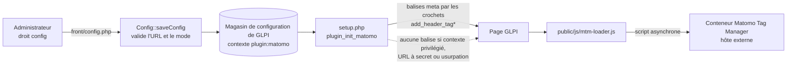
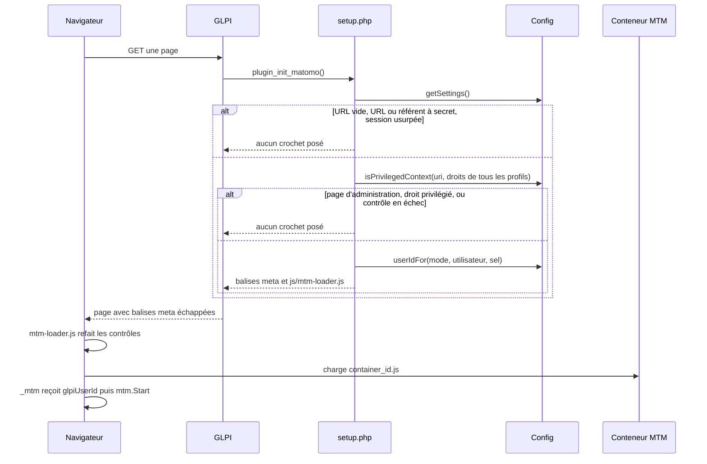

# Architecture — Matomo Tag Manager pour GLPI

## Objectifs et contraintes

- Charger un conteneur Matomo Tag Manager dans GLPI **sans modifier un gabarit ni un fichier du cœur**.
- Le conteneur est du code tiers modifiable par ses éditeurs : il ne doit jamais tourner là où il pourrait agir en
  administrateur ni emporter un jeton secret.
- Aucune table de base de données ; aucun fichier écrit à l'exécution.
- Logique pure (`src/Config.php`) testable sans GLPI, avec des bouchons (`tests/stubs.php`).
- Cible : GLPI 11.x (`setup.php`).

## Vue d'ensemble

## Composants

| Composant | Rôle |
|---|---|
| `setup.php` | Déclare le greffon, ses prérequis, et décide à chaque requête quels crochets poser (`plugin_init_matomo`) |
| `src/Config.php` | Réglages, validation de l'URL, détection de secret dans une URL, contexte privilégié, sel et pseudonyme, balises d'en-tête, formulaire |
| `front/config.php` | Page de réglages ; exige `config` en mise à jour |
| `hook.php` | Installation (crée le sel) et désinstallation (supprime les clés) |
| `public/js/mtm-loader.js` | Seconde couche : refait les contrôles côté navigateur, pousse `glpiUserId`, charge le conteneur |
| `tests/` | 46 tests PHP (`run.php`, bouchons GLPI) et 9 tests du chargeur réel (`node --test`, bac à sable `vm`) |

## Parcours principal : une page d'utilisateur

Sur les pages anonymes, les crochets `add_header_tag_anonymous_page` et `add_javascript_anonymous_page` ne sont posés que si
`track_anonymous` vaut `1` et que le contexte n'est pas privilégié ; aucune identité n'y est jamais envoyée.

## Données

Pas de modèle relationnel : quatre clés dans le contexte `plugin:matomo` (voir
[ADMINISTRATION.md](ADMINISTRATION.md#configuration)). Le sel est chiffré par la clé de GLPI.

## Déploiement

Le greffon se dépose dans `plugins/matomo/` de GLPI ; le nom du dossier est la clé du greffon, pas celui du dépôt. Le dépôt
est canonique sur Forgejo ; une copie publique sur GitHub est alimentée par un miroir (`gitupdate` de `plugin.xml`).
Une montée de version impose la réinstallation.

## Décisions

| Décision | Motif | ADR |
|---|---|---|
| Consigner les décisions | Retrouver le pourquoi avant de changer | [0001](adr/0001-consigner-les-decisions.md) |
| Réglages en balises `<meta>`, jamais en JavaScript | GLPI les échappe ; rien d'exécutable ne passe par la configuration | — |
| Aucun conteneur pour un droit privilégié, en n'importe quel profil de la session | Le conteneur est du code tiers, il agirait en administrateur | [0002](adr/0002-pas-de-conteneur-pour-les-administrateurs.md) |
| Contrôles doublés dans le chargeur, motifs recopiés mot pour mot | Seconde couche ; un test échoue si les motifs divergent | — |
| Pseudonyme par HMAC avec le sel propre du greffon, non la clé maîtresse de GLPI | Ne pas réutiliser la clé qui protège tous les identifiants stockés | — |
| Échec fermé : un contrôle de droit qui échoue vaut « privilégié » | Mieux vaut ne pas suivre que charger du code tiers par erreur | — |

## Qualité et risques

- Les tests chargent le vrai `setup.php`, le vrai `Config.php` et le vrai chargeur, avec des bouchons de GLPI ; `tests/mutations/hardening-20261025.json`
  décrit des mutations du code (fichier, texte d'origine, texte muté) pour éprouver les gardes ; le lanceur qui les
  applique n'est pas dans ce dépôt (à vérifier).
- **Risque résiduel** : le conteneur reste du code tiers pour tous les utilisateurs non privilégiés ; voir
  [SECURITE.md](SECURITE.md#écarts-connus).
- Le greffon n'a été éprouvé de bout en bout que par le banc navigateur ([captures](captures/README.md)), sur une instance de test.

## Glossaire

| Terme | Term |
|---|---|
| Conteneur (MTM) | Container (MTM) |
| Couche de données | Data layer |
| Pseudonyme | Pseudonym |
| Sel | Salt |
| Contexte privilégié | Privileged context |
| Usurpation d'identité (*Impersonate*) | Impersonation |
