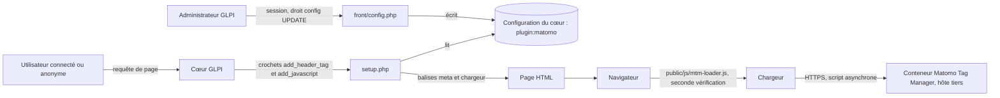
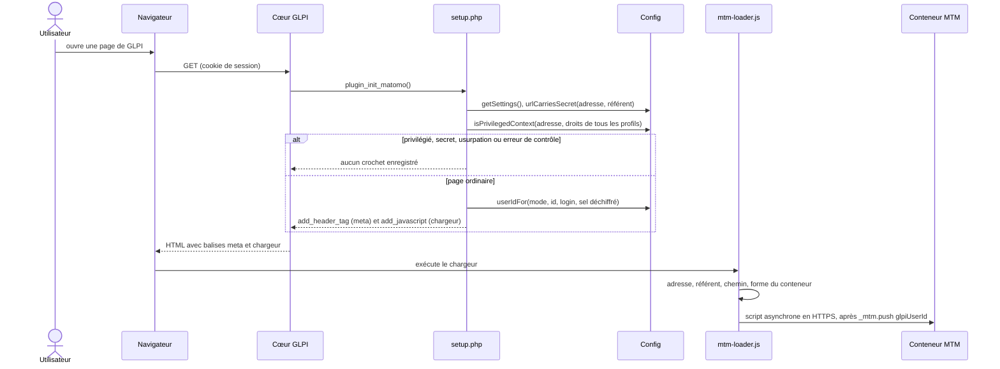
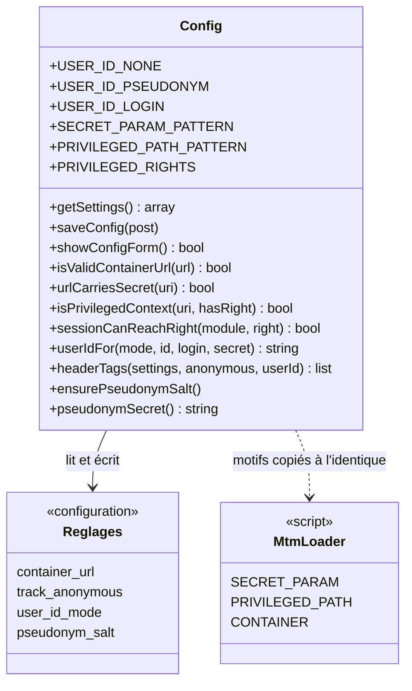
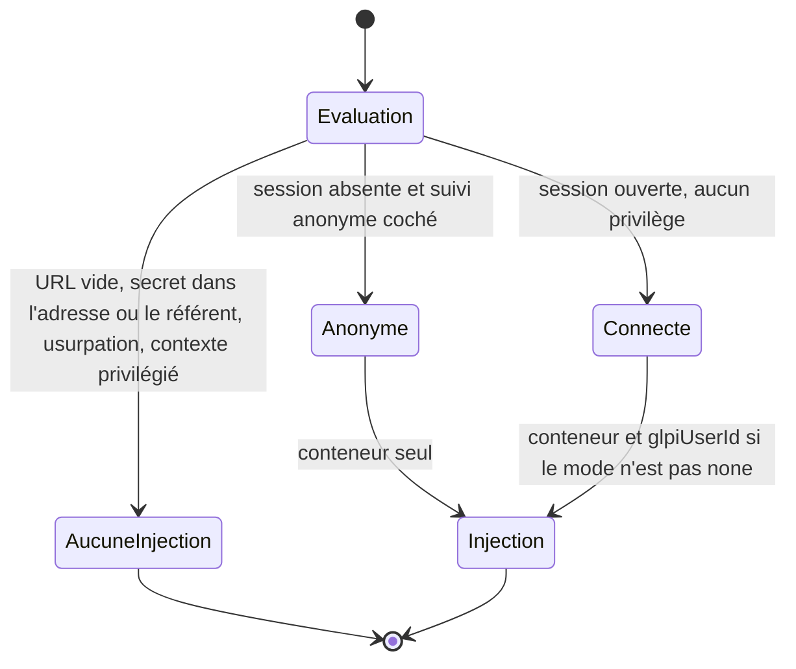

# Architecture — Matomo Tag Manager

Document destiné au propriétaire et aux développeurs (plan inspiré d'arc42, vues du modèle C4).
La sécurité est détaillée dans [SECURITE.md](SECURITE.md) ; les décisions dans [adr/](adr/).

## Objectifs et contraintes

- **Objectif** : charger un conteneur Matomo Tag Manager (MTM) dans les pages de GLPI, sans modifier
  le cœur, avec une identité facultative pour Matomo — et sans exposer les sessions privilégiées ni les
  secrets d'URL à ce code tiers.
- **Contraintes** :
  - GLPI 11.x (`PLUGIN_MATOMO_MIN_GLPI` 11.0.0, `PLUGIN_MATOMO_MAX_GLPI` 11.99.99), PHP 8.2 ou plus,
    `declare(strict_types=1)` ;
  - **aucune table propre**, aucun fichier écrit à l'exécution : réglages dans la configuration du
    cœur, contexte `plugin:matomo` ;
  - les réglages arrivent à la page comme **données** (balises `<meta>` échappées par GLPI), jamais
    comme JavaScript généré ([ADR 0001](adr/0001-reglages-par-balises-meta.md)) ;
  - le conteneur est du code tiers mutable : garde-fous côté serveur **et** dans le chargeur
    ([ADR 0002](adr/0002-garde-fous-serveur-et-chargeur.md)) ;
  - la mesure des pages anonymes est **désactivée par défaut**.
- **Hors périmètre** : l'installation et l'exploitation de Matomo lui-même, le recueil du
  consentement des utilisateurs (la responsabilité en revient à l'organisme), les traductions
  (libellés anglais seulement).

## Contexte

## Composants

| Composant | Fichier | Rôle |
|---|---|---|
| Initialisation et décision | `setup.php` | déclare la version et les prérequis ; `plugin_init_matomo()` applique les garde-fous et enregistre les crochets ; `check_prerequisites()` ne touche que le cœur |
| Installation | `hook.php` | `plugin_matomo_install()` crée le sel du pseudonyme ; `plugin_matomo_uninstall()` supprime les quatre clés |
| Logique et réglages | `src/Config.php` (`GlpiPlugin\Matomo\Config`) | lecture et validation des réglages, forme de l'URL, détection des secrets, chemins et droits privilégiés, pseudonyme, balises d'en-tête, formulaire |
| Page de réglages | `front/config.php` | exige `config` en mise à jour, appelle `saveConfig()` et `showConfigForm()` |
| Chargeur | `public/js/mtm-loader.js` | relit les balises, refait les contrôles, pousse `glpiUserId`, démarre MTM |
| Tests | `tests/` | `run.php` (PHP, 46 tests), `loader.test.js` (le vrai chargeur dans `vm`, 9 tests), `mutations/` (manifeste des mutations de durcissement) |

## Parcours principal

Chargement d'une page par un utilisateur connecté sans droit d'administration, identité en mode
pseudonyme.

## Modèle de données

Pas de table. Les réglages sont quatre clés de la configuration du cœur ; la classe `Config` porte
toute la logique.

L'état de décision d'une page est simple : *aucune injection* (plugin inactif, URL vide, secret,
privilège, usurpation) ou *injection* (conteneur, plus identité si connecté et mode non nul).

## Déploiement

Un dossier `plugins/matomo/` dans GLPI ; rien d'autre. Le conteneur MTM est servi par l'hôte Matomo de
l'organisme, que le navigateur contacte directement en HTTPS : GLPI ne relaie rien. Le chargeur est un
fichier statique servi par GLPI (`public/js/`). Voir [ADMINISTRATION.md](ADMINISTRATION.md#installation).

## Décisions

| ADR | Décision |
|---|---|
| [0001](adr/0001-reglages-par-balises-meta.md) | Transmettre les réglages par balises `<meta>` et un chargeur statique, pas par du JavaScript généré |
| [0002](adr/0002-garde-fous-serveur-et-chargeur.md) | Garde-fous doublés : serveur (décisif) et chargeur (seconde couche) |
| [0003](adr/0003-pseudonyme-hmac-et-sel-propre.md) | Pseudonyme par HMAC-SHA256 avec un sel propre au greffon, jamais la clé de GLPI |

## Qualité et risques

- **Dérive des motifs** : les deux motifs (secrets, chemins privilégiés) existent en PHP et en
  JavaScript ; `testLoaderUsesTheSamePatterns` échoue s'ils divergent.
- **Mutations** : `tests/mutations/hardening-20261025.json` liste les mutations du durcissement du
  25 octobre 2026 que la suite doit détecter (comment les rejouer : à vérifier, aucun lanceur n'est
  versionné dans le dépôt).
- **Risque résiduel** : le contenu du conteneur MTM n'est pas maîtrisé par le greffon ; voir
  [SECURITE.md](SECURITE.md#le-risque-principal--du-code-tiers-dans-lorigine-glpi).
- **Dette connue** : pas de traduction ; pas de consentement intégré ; liste de chemins privilégiés à
  tenir à jour à chaque version majeure de GLPI (routes Symfony).

## Glossaire

| Français | English |
|---|---|
| conteneur (MTM) | container (MTM) |
| couche de données | data layer |
| pseudonyme | pseudonym |
| sel | salt |
| contexte privilégié | privileged context |
| échec fermé | fail closed |
| usurpation (de session) | impersonation |
| référent | referrer |
