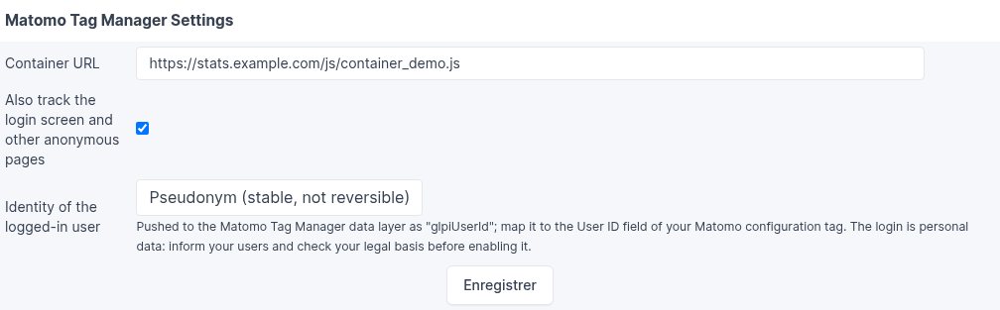

# User guide — Matomo Tag Manager for GLPI

[Français](GUIDE.md) · **English**

For the GLPI administrator who wants to follow how the instance is used in Matomo. You need GLPI's configuration right
(`config` UPDATE).

## Set the container

1. Go to **Setup → Plugins**, then the configuration link of **Matomo Tag Manager**.
2. In **Container URL**, paste the container address, for example
   `https://stats.example.com/js/container_XXXXXXXX.js`.
3. Click **Save**.

Expected result: the message "Configuration saved"; the container is loaded on the next page of a logged-in user without
administration rights. An address that is not HTTPS, or that carries credentials, a query or a fragment, is refused and
nothing is stored.

## Track the login screen too

1. On the settings page, tick **Also track the login screen and other anonymous pages**.
2. Click **Save**.

Expected result: the container also loads on the login screen. No identity is sent there, and a page whose address
carries a token (password-reset link) is never tracked. Untick the box to go back to the default.

## Send the user's identity to Matomo

1. First: have a legal basis, inform your users and update your privacy notice.
2. On the settings page, choose in **Identity of the logged-in user**: **Pseudonym (stable, not reversible)**
   (recommended) or **GLPI login (personal data)**.
3. Click **Save**.
4. In Matomo Tag Manager, create a *Data Layer* variable `glpiUserId`, then set it as the **User ID** of your
   *Matomo Configuration* variable.

Expected result: every page of a logged-in user pushes `glpiUserId` before MTM starts. Choose **Do not send** to stop.

## Check that tracking works

1. Log in with an account **without** administration rights.
2. Open any page (for example the home page) and the browser's developer tools.
3. In the console, type `window._mtm`: the array must contain the `mtm.Start` event (and `glpiUserId` if an identity
   is chosen).

Expected result: the container is loaded. With an administrator account, or on a configuration page, `window._mtm`
stays undefined: this is by design (see [SECURITE.md](SECURITE.md), in French).
