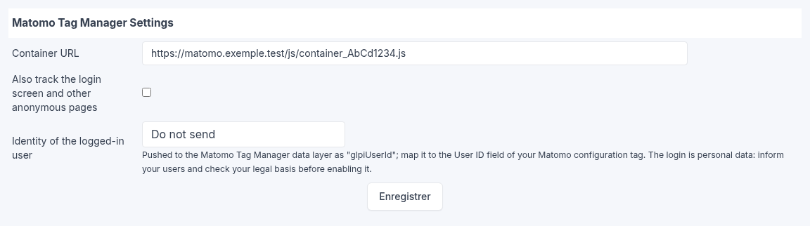
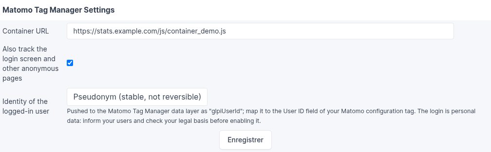

# Guide d'utilisation — Matomo Tag Manager

**Français** · [English](GUIDE.en.md)

Ce guide dit comment accomplir les tâches courantes. Le manuel destiné aux utilisateurs de GLPI
(ce que le greffon mesure, vie privée) est dans [MANUEL.md](MANUEL.md) ; installation, options et
dépannage sont dans [ADMINISTRATION.md](ADMINISTRATION.md). Le greffon n'ajoute ni menu ni onglet :
sa page de réglages s'ouvre depuis **Configuration → Plugins** (icône de configuration de
**Matomo Tag Manager**) et exige le droit de modifier la configuration de GLPI. Les libellés propres au
greffon sont en anglais dans toutes les langues ; seul le bouton d'enregistrement vient du cœur de GLPI
(**Enregistrer** en français).

## Renseigner l'URL du conteneur

Brancher GLPI sur votre conteneur Matomo Tag Manager. Tant que le champ est vide, **rien n'est mesuré**.

1. Dans Matomo Tag Manager, publiez votre conteneur et copiez l'adresse de son script
   (`https://stats.example.com/js/container_AbCd1234.js`).
2. Dans GLPI, ouvrez **Configuration → Plugins → Matomo Tag Manager** (icône de configuration).
3. Collez l'adresse dans **Container URL**.
4. Cliquez sur **Save** (**Enregistrer** dans l'interface française).

Résultat attendu : le message « Configuration saved » s'affiche et le conteneur se charge sur la page
suivante des utilisateurs connectés sans droit d'administration. Une adresse qui n'est pas en HTTPS,
qui porte un identifiant, une requête ou un fragment, ou dont le chemin ne finit pas par
`/container_<identifiant>.js` est refusée.

## Mesurer aussi l'écran de connexion

Compter les visites de l'écran de connexion et des autres pages anonymes (réinitialisation du mot de
passe, par exemple). **Désactivé par défaut.**

1. Ouvrez la page de réglages.
2. Cochez **Also track the login screen and other anonymous pages**.
3. Cliquez sur **Save** (**Enregistrer** dans l'interface française).

Résultat attendu : le conteneur se charge sur ces pages. Aucune identité n'y est envoyée, et une page
dont l'adresse (ou le référent) porte un jeton n'est jamais mesurée.

## Activer l'identité pseudonymisée

Savoir qu'une même personne revient, sans que Matomo connaisse son identifiant GLPI. Le pseudonyme
**reste une donnée personnelle** : avant d'activer, vérifiez votre base légale et informez les
utilisateurs (voir [SECURITE.md](SECURITE.md#données-personnelles)).

1. Ouvrez la page de réglages.
2. Dans **Identity of the logged-in user**, choisissez **Pseudonym (stable, not reversible)**.
3. Cliquez sur **Save** (**Enregistrer** dans l'interface française).

Résultat attendu : chaque page d'un utilisateur connecté pousse `glpiUserId` dans la couche de données
de MTM avant le démarrage du conteneur. Le choix **GLPI login (personal data)** envoie l'identifiant
en clair : à éviter, sauf nécessité établie.

## Exploiter l'identité dans Matomo

Relier `glpiUserId` au champ **User ID** de Matomo.

1. Dans Matomo Tag Manager, créez une variable de type *Data Layer* nommée `glpiUserId`.
2. Ouvrez votre variable de configuration Matomo et affectez cette variable au champ **User ID**.
3. Publiez une nouvelle version du conteneur.

Résultat attendu : les visites d'une même personne sont regroupées sous le même User ID. Côté Matomo,
activez l'anonymisation des adresses IP, respectez *Do Not Track* ou proposez une désinscription, et
excluez les paramètres `password_forget_token`, `token` et `_glpi_csrf_token` dans les réglages du site.

## Désactiver la mesure

Arrêter immédiatement toute mesure, sans désinstaller le greffon.

1. Ouvrez la page de réglages.
2. Videz **Container URL**.
3. Cliquez sur **Save** (**Enregistrer** dans l'interface française).

Résultat attendu : plus aucun script n'est chargé, quel que soit l'état des autres réglages. Pour
retirer aussi les réglages enregistrés, désinstallez le greffon (voir
[ADMINISTRATION.md](ADMINISTRATION.md#mise-à-jour-et-désinstallation)).

## Questions fréquentes

**Pourquoi rien n'est mesuré quand je teste avec mon compte administrateur ?** Le conteneur ne se
charge jamais pour une session qui peut changer la configuration, les profils ou les comptes, ni sur
les pages d'administration : c'est voulu. Testez avec un compte sans droit d'administration.

**Peut-on mesurer les techniciens ?** Oui, tant que leur profil (et aucun de leurs autres profils)
n'ouvre un des droits d'administration listés dans [SECURITE.md](SECURITE.md#menaces-et-mesures).

**Le pseudonyme change-t-il ?** Il est stable tant que le sel du greffon ne change pas ; il change
si le greffon est désinstallé puis réinstallé.
